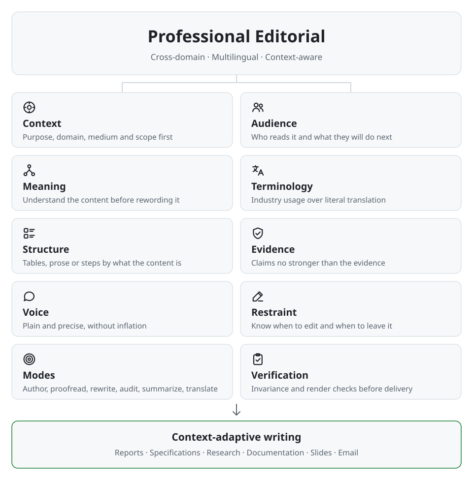

<p align="center">
  <picture>
    <source media="(prefers-color-scheme: dark)" srcset="assets/capabilities-dark.svg">
    <source media="(prefers-color-scheme: light)" srcset="assets/capabilities-light.svg">
    
  </picture>
</p>

<p align="center">
  An <a href="https://skills.sh/">Agent Skill</a> for writing and editing professional documents in any domain, in English, Vietnamese or mixed-language text.<br>
  Works with Claude Code, Codex, Cursor and other agents that support the Agent Skills format.
</p>

<p align="center">
  <a href="#install">Install</a> ·
  <a href="#capabilities">Capabilities</a> ·
  <a href="#modes">Modes</a> ·
  <a href="#verification-scripts">Verification</a> ·
  <a href="#evaluation">Evaluation</a>
</p>

---

## Why

Agents write fluent text that often fails in predictable ways. It changes technical meaning while improving wording, it states claims more strongly than the data supports, it translates established terms word for word, it rewrites sentences that were already fine, and it adds sections to look complete. `professional-editorial` gives the agent a way to judge these choices. It is not a list of banned words: it sets out how to establish the reader and purpose, what each editing mode may and may not change, and how to verify an edit before delivering it.

## Install

```bash
npx skills add hai0901/professional-editorial --skill professional-editorial -g
```

`-g` installs for your user account, so every project can use the skill. Add `-a claude-code -a codex` to choose agents, or leave it out to choose interactively. To install from a local clone:

```bash
npx skills add ./professional-editorial --skill professional-editorial -g
```

Update later with `npx skills update`.

The skill activates when an agent drafts, proofreads, rewrites, audits, summarizes or translates a document meant for other people: reports, specifications, ADRs, benchmark write-ups, proposals, status updates, READMEs, handovers, slide text, emails. It does not activate for ordinary chat replies or code comments.

## Capabilities

| Capability | What the agent does | Defined in |
|---|---|---|
| **Context** | Establishes purpose, domain, medium, scope and the real source file before writing | `SKILL.md` §3 |
| **Audience** | Sets emphasis and depth by who reads the document and what they will do with it | `references/audience-and-doc-types.md` |
| **Meaning** | Understands the mechanism behind a sentence before rewording it; flags what it cannot resolve | `SKILL.md` §4 |
| **Terminology** | Keeps identifiers verbatim, uses the terms practitioners actually use, defines abbreviations once | `SKILL.md` §4, `references/vietnamese.md` |
| **Structure** | Chooses tables, prose, steps or diagrams by what the content is; keeps headings and TOC consistent | `SKILL.md` §4 |
| **Evidence** | Separates fact, inference, hypothesis, proposal and unknown; keeps caveats next to their numbers | `references/evidence-and-claims.md` |
| **Voice** | Writes plainly and precisely, without inflation, while keeping real technical depth | `SKILL.md` §4, `references/anti-slop.md` |
| **Restraint** | Leaves good text alone; reports out-of-scope problems instead of silently fixing them | `SKILL.md` §2, §4 |
| **Modes** | Applies explicit change rules for author, proofread, rewrite, audit, summarize and translate | `SKILL.md` §2 |
| **Verification** | Checks numbers, code, formulas and layout before claiming an edit is safe | `SKILL.md` §5, `scripts/` |

### Rule levels

| Level | Meaning | Examples |
|---|---|---|
| **L1** Non-negotiable | A breach fails the deliverable | No invented facts or results; no meaning change outside scope; no unperformed checks reported as done |
| **L2** Professional defaults | Apply unless the task says otherwise | Plain language, no padding, no promotional tone |
| **L3** Contextual judgment | Decided per task | Terminology, length, depth, structure |
| **L4** Project conventions | Override L2 and L3, never L1 | Glossaries, templates, `AGENTS.md`, house style |

## Modes

| Mode | May change | Must keep | Delivers |
|---|---|---|---|
| Author | Everything | Facts from sources | The document |
| Proofread | Wording that is wrong, unclear or unnatural | Meaning, numbers, formulas, identifiers, structure | Edited text, change table, technical issues flagged separately |
| Rewrite | Sentences and structure within scope | Meaning, facts, conclusions | Rewritten text and a note on structural changes |
| Audit | Nothing | Everything | Ranked findings with location and suggested fix |
| Summarize | Length and selection | Meaning, qualifiers, attribution | Summary sized for the reader's decision |
| Translate | Language | Meaning, register, identifiers, numbers | Translation with untranslatable terms explained once |

When a request is ambiguous ("polish this"), the agent uses the narrowest mode that satisfies it and says which mode it used.

## Verification scripts

Both scripts use only the Python standard library.

**`invariance_check.py`** compares an original and an edited document (HTML, Markdown or plain text) for content that editing must not change: numbers, inline code, code blocks, formula blocks, headings and table shapes. Every reported difference must correspond to an intended edit.

```bash
python3 scripts/invariance_check.py report.html report.edited.html
```

```text
format: html

[code spans]
  added   x1: replay()
  added   x2: OPTIMAL

[html tags]
  added   x3: code

[numbers]
  added   x1: 5%
```

Here the editor wrapped three identifiers in `<code>` and added "phân vị 5%" to explain `p05`. All four differences are intended. Anything else would need to be reverted.

**`render_compare.py`** renders two HTML files to PDF with headless Chrome or Chromium and reports page counts. It also shows per-page text changes when `pdftotext`, `pdfplumber` or `pypdf` is available.

```bash
python3 scripts/render_compare.py report.html report.edited.html
```

## Language support

The core instructions are language-neutral. Vietnamese has its own reference file. It covers a procedure for choosing terms (keep the identifier, use the established Vietnamese term, keep the working English term, or describe and gloss), 13 recurring problems with before-and-after examples (calques, note-style fragments, slang, personified software, nominalization chains and others), number and punctuation conventions, and register by genre. Further language references can be added under `references/`.

## Evaluation

`evals/cases.json` contains 17 cases across engineering, research, management and communication tasks. Each case lists the expected behaviour and its hard-fail conditions. The protocol in `evals/README.md` runs every case without the skill, with it, and with it on a second agent. Hard fails are checked first, deterministically where possible. The outputs with and without the skill are then compared blind.

Results have not been published yet. Treat the skill as untested until they are.

## Repository layout

```text
skills/professional-editorial/
├── SKILL.md                         core instructions and module routing
├── references/
│   ├── vietnamese.md
│   ├── evidence-and-claims.md
│   ├── anti-slop.md
│   └── audience-and-doc-types.md
├── scripts/
│   ├── invariance_check.py
│   └── render_compare.py
└── evals/
    ├── cases.json
    └── README.md
assets/                              README banner (dark and light)
```

## Project conventions

Glossaries, reader-facing terms and templates belong in each project's own repository, not in this skill. The skill tells the agent to look for them (`AGENTS.md`, `CLAUDE.md`, style guides, glossaries) and treats them as overriding its defaults.

## Contributing

When the skill produces a poor result in real use, add a case to `evals/cases.json` with the smallest input that reproduces it, the expected behaviour and the hard fail. Then change the relevant reference file and re-run the full case set to check for regressions. Remove confidential names and figures from inputs.
